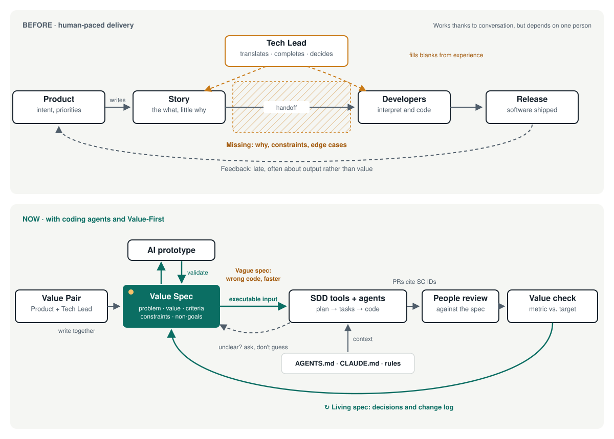

  

<strong>From ritual to value, from spec to software.</strong>

  <a href="README.pt-BR.md">Português</a> ·
  <a href="docs/en/why.md">Why</a> ·
  <a href="docs/en/principles.md">Principles</a> ·
  <a href="templates/en/value-spec.md">Value Spec template</a> ·
  <a href="LICENSE">MIT</a>

---

**Value-First Development makes the value of each piece of work explicit, shared and measurable before anyone builds it, so that people and coding agents build the right thing, not only build it fast.**

It's a light layer on top of the way you already work, whether that's Scrum, Kanban or your own process. You keep your cadence and tools. It adds one short, living document per item of value, written by Product and the Tech Lead together.

## The problem

In our experience, in many teams the ceremonies stay while the purpose fades. Stories arrive describing *what*, rarely *why*, and almost never the constraints or how success will be measured. Someone fills that gap, and it's usually the Tech Lead: translating, completing and deciding, mostly unseen.

That used to be a nuisance. With coding agents, it's a bottleneck. A colleague compensates for a vague spec with conversation and judgement. An agent executes what's written and guesses the rest. **A vague spec now produces the wrong code faster.**

DORA's 2025 research describes AI as an amplifier of the system it lands in. Without a focus on users, adopting it can hurt team performance ([DORA 2025](https://cloud.google.com/blog/products/ai-machine-learning/announcing-the-2025-dora-report)).

→ [Why Value-First](docs/en/why.md) · [Specs in the AI era](docs/en/ai-and-specs.md)

## The idea

| | |
|---|---|
| **Value Spec** | One page per item: problem, expected value, measurable success criteria, constraints, what's fixed and what's flexible. Versioned next to the code. Readable by people and agents. |
| **Value Pair** | Product owns the problem and the value. The Tech Lead owns feasibility and makes the spec buildable. The translation work gets a name and a partner. |
| **The cycle** | Specify → Validate → Build → Check value, then back to the spec. It runs inside the cadence you already have. |

## Six principles

1. **Value is explicit before the work starts.**
2. **The spec is a value contract, and it lives.**
3. **Validate before you build.** Cheap prototypes, often AI-generated, answer one question at a time.
4. **Product and Tech specify together.**
5. **A changed plan is information, not failure.**
6. **People own the outcome; AI speeds it up.**

→ [Principles](docs/en/principles.md) · [Practices](docs/en/practices.md)

## You're Value-First if…

- every relevant item in progress has a Value Spec with at least one measurable success criterion;
- every spec has two named owners, Product and Tech;
- specs live in the repo and your agent instructions point to them;
- risky items get a prototype or spike (a short technical experiment) before the commitment;
- scope changes show up as spec changes, with a reason;
- you check value after delivery, and can name what *didn't* work;
- people review all AI-generated code.

→ [Full checklist and maturity model](docs/en/adoption.md)

## How it relates to what you use

Value-First doesn't compete with Scrum, Kanban, Shape Up or spec-driven tools like GitHub Spec Kit and Kiro. It sits above them: it decides *what is worth building and how we'll know*, and they handle the rest. Its closest relative is Shape Up, and it borrows openly from Specification by Example and outcome-focused product work.

→ [Honest comparison](docs/en/comparison.md)

## Start this week

1. Pick one upcoming item with real value and some uncertainty.
2. Write a [Value Spec](templates/en/value-spec.md) as a pair. Keep it to a page.
3. Validate the riskiest assumption with the cheapest prototype.
4. Add the [agent snippet](templates/en/agents-snippet.md) to your AGENTS.md or CLAUDE.md.
5. Build, then check the value on the date you set.

## Documentation

| | |
|---|---|
| [Why Value-First](docs/en/why.md) | The thesis and the Tech Lead's role |
| [Specs in the AI era](docs/en/ai-and-specs.md) | Spec-driven development, agents, limits and risks |
| [Principles](docs/en/principles.md) · [Practices](docs/en/practices.md) | The core |
| [Roles and artifacts](docs/en/roles-and-artifacts.md) | Value Pair, Value Spec, agent snippet, Canvas |
| [Adoption](docs/en/adoption.md) | Checklist, maturity model, first week, when not to use it |
| [Comparison](docs/en/comparison.md) · [FAQ](docs/en/faq.md) | Scrum, Kanban, Shape Up, spec-driven development |
| [Scenarios](docs/en/case-studies.md) · [Templates](docs/en/templates.md) · [Sources](docs/en/sources.md) | Examples and references |

## Contributing

Ideas, critiques, translations and real-world experience are welcome. See [CONTRIBUTING.md](CONTRIBUTING.md) and the [changelog](CHANGELOG.md).

Created by [André Lara Amorim](https://github.com/andrelaf). Formerly *Deliver-Value Framework*. The v1 text is preserved in [docs/archive/v1](docs/archive/v1/). Licensed under [MIT](LICENSE).
