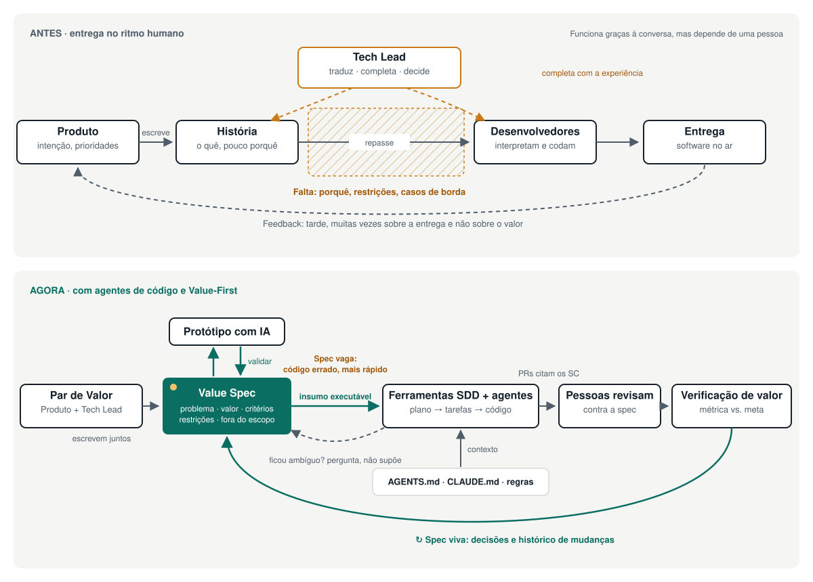

  

<strong>Do ritual ao valor, da spec ao software.</strong>

  <a href="README.md">English</a> ·
  <a href="docs/pt/why.md">Por quê</a> ·
  <a href="docs/pt/principles.md">Princípios</a> ·
  <a href="templates/pt/value-spec.md">Template de Value Spec</a> ·
  <a href="LICENSE">MIT</a>

---

**O Value-First Development torna o valor de cada trabalho explícito, compartilhado e mensurável antes que alguém comece a construí-lo, para que pessoas e agentes de código construam a coisa certa, e não apenas construam rápido.**

É uma camada leve sobre a forma como você já trabalha, seja Scrum, Kanban ou um processo próprio. Você mantém sua cadência e suas ferramentas. A novidade é um documento curto e vivo para cada item de valor, escrito em conjunto por Produto e pelo Tech Lead.

## O problema

Em muitos times, as cerimônias continuam e o propósito se perde. As histórias chegam descrevendo *o quê*, raramente o *porquê*, e quase nunca as restrições ou como o sucesso será medido. Alguém preenche esse abismo, e geralmente é o Tech Lead: traduzindo, completando e decidindo, quase sempre sem que ninguém veja.

Antes isso era um incômodo. Com agentes de código, virou um gargalo. Um colega compensa uma spec vaga com conversa e bom senso. Um agente executa o que está escrito e adivinha o resto. **Uma spec vaga agora produz o código errado mais rápido.**

A pesquisa do DORA de 2025 descreve a IA como um amplificador do sistema em que ela chega. Sem foco nos usuários, adotá-la pode prejudicar o desempenho do time ([DORA 2025](https://cloud.google.com/blog/products/ai-machine-learning/announcing-the-2025-dora-report)).

→ [Por que Value-First](docs/pt/why.md) · [Specs na era da IA](docs/pt/ai-and-specs.md)

## A ideia

| | |
|---|---|
| **Value Spec** | Uma página por item: problema, valor esperado, critérios de sucesso mensuráveis, restrições, o que é fixo e o que é flexível. Versionada junto ao código. Legível por pessoas e agentes. |
| **Par de Valor** | Produto é dono do problema e do valor. O Tech Lead é dono da viabilidade e torna a spec construível. O trabalho de tradução ganha um nome e um parceiro. |
| **O ciclo** | Especificar → Validar → Construir → Verificar o valor, e de volta à spec. Roda dentro da cadência que você já tem. |

## Seis princípios

1. **O valor fica explícito antes de o trabalho começar.**
2. **A spec é um contrato de valor, e ela é viva.**
3. **Valide antes de construir.** Protótipos baratos, muitas vezes gerados por IA, respondem uma pergunta de cada vez.
4. **Produto e Tecnologia especificam juntos.**
5. **Um plano que muda é informação, não fracasso.**
6. **Pessoas são donas do resultado; a IA acelera.**

→ [Princípios](docs/pt/principles.md) · [Práticas](docs/pt/practices.md)

## Você é Value-First se…

- todo item em andamento tem uma Value Spec com pelo menos um critério de sucesso mensurável;
- toda spec tem dois responsáveis nomeados, um de Produto e um de Tecnologia;
- as specs ficam no repositório e as instruções dos seus agentes apontam para elas;
- itens arriscados passam por um protótipo ou spike antes do compromisso;
- mudanças de escopo aparecem como mudanças na spec, com um motivo;
- vocês verificam o valor depois da entrega e conseguem dizer o que *não* funcionou;
- pessoas revisam todo o código gerado por IA.

→ [Checklist completo e modelo de maturidade](docs/pt/adoption.md)

## Como se relaciona com o que você já usa

O Value-First não compete com Scrum, Kanban, Shape Up nem com ferramentas de desenvolvimento orientado a specs, como GitHub Spec Kit e Kiro. Ele fica acima deles: decide *o que vale a pena construir e como vamos saber*, e eles cuidam do resto. O parente mais próximo é o Shape Up, e o Value-First se inspira abertamente em Specification by Example e no trabalho de produto orientado a resultados.

→ [Comparação honesta](docs/pt/comparison.md)

## Comece esta semana

1. Escolha um próximo item com valor real e alguma incerteza.
2. Escreva uma [Value Spec](templates/pt/value-spec.md) em par. Mantenha em uma página.
3. Valide a suposição mais arriscada com o protótipo mais barato.
4. Adicione o [snippet para agentes](templates/pt/agents-snippet.md) ao seu AGENTS.md ou CLAUDE.md.
5. Construa e, na data combinada, verifique o valor.

## Documentação

| | |
|---|---|
| [Por que Value-First](docs/pt/why.md) | A tese e o papel do Tech Lead |
| [Specs na era da IA](docs/pt/ai-and-specs.md) | Desenvolvimento orientado a specs, agentes, limites e riscos |
| [Princípios](docs/pt/principles.md) · [Práticas](docs/pt/practices.md) | O núcleo |
| [Papéis e artefatos](docs/pt/roles-and-artifacts.md) | Par de Valor, Value Spec, snippet para agentes, Canvas |
| [Adoção](docs/pt/adoption.md) | Checklist, modelo de maturidade, primeira semana, quando não usar |
| [Comparação](docs/pt/comparison.md) · [FAQ](docs/pt/faq.md) | Scrum, Kanban, Shape Up, SDD |
| [Cenários](docs/pt/case-studies.md) · [Templates](docs/pt/templates.md) · [Fontes](docs/pt/sources.md) | Exemplos e referências |

## Como contribuir

Ideias, críticas, traduções e experiências reais são bem-vindas. Veja o [CONTRIBUTING.md](CONTRIBUTING.md) e o [changelog](CHANGELOG.md).

Criado por [André Lara Amorim](https://github.com/andrelaf). Antes chamado *Deliver-Value Framework*. O texto da v1 está preservado em [docs/archive/v1](docs/archive/v1/). Licenciado sob [MIT](LICENSE).
