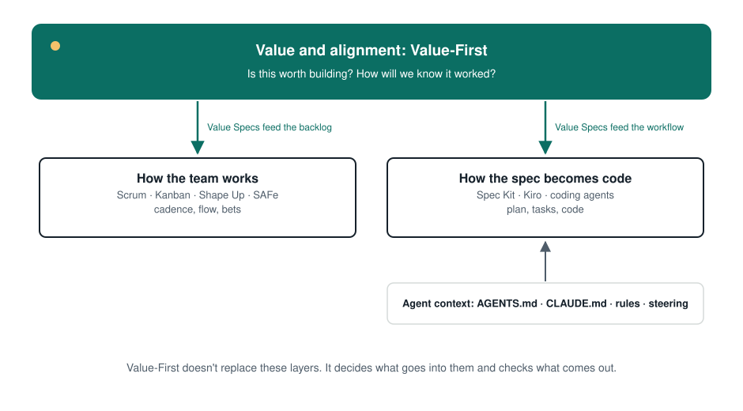

# How Value-First compares

An honest comparison. Every approach below solves real problems well. Value-First is a layer that works **with** most of them.

## At a glance

| | **Value-First** | **Scrum** | **Kanban** | **Shape Up** | **Spec-driven development** |
|---|---|---|---|---|---|
| **Main question** | Is this worth building, and how will we know it worked? | How do we inspect and adapt in short cycles? | How does work flow, and where does it get stuck? | What's worth betting on, and how much time is it worth? | How do we turn intent into plan, tasks and code with agents? |
| **Unit** | One item of value (Value Spec) | Sprint and Product Backlog Item | Work item on a board | Six-week cycle and pitch | Feature spec |
| **Cadence** | None of its own. Uses yours. | Fixed sprints of a month or less | Continuous | 6-week cycles + 2-week cool-down | None of its own |
| **Roles** | Value Pair (Product + Tech Lead), no new titles | Product Owner, Scrum Master, Developers | None required | Shapers, builders, betting table | None required |
| **Central artifact** | Value Spec (living, in the repo) | Product Backlog, Sprint Backlog, Increment | Board, WIP limits, explicit policies | Pitch | Spec, plan, tasks |
| **How value is measured** | Success criteria with metric, baseline, target and a value check date | Product Goal; Sprint Review inspects the Increment | Flow metrics (lead time, throughput) | Appetite and hill charts. Not prescriptive about outcome metrics | Not covered |
| **AI agents** | The spec is written to be read by agents | Not covered (tool-agnostic) | Not covered (tool-agnostic) | Not covered | Core purpose |
| **Relationship** | — | **Complementary**: improves sprint input and adds a later value check | **Complementary**: the readiness check becomes a column policy | **Closest relative**: overlaps on shaping, complementary on the rest | **Complementary**: Value-First sits above it |

Sources: [Scrum Guide 2020](https://scrumguides.org/scrum-guide.html) · [Kanban Guide](https://kanbanguides.org/english/) and Anderson, *Kanban* (2010) · [Shape Up](https://basecamp.com/shapeup) · [GitHub Spec Kit](https://github.com/github/spec-kit), [Kiro](https://kiro.dev/docs/specs/), [Böckeler 2025](https://martinfowler.com/articles/exploring-gen-ai/sdd-3-tools.html).

## In more detail

### Scrum
**What it does well:** cadence, transparency, inspection and adaptation, cross-functional teams, a Product Goal.
**How Value-First fits:** it doesn't touch Scrum's events or accountabilities. Value Specs make Product Backlog Items ready for refinement, and the value check extends the Sprint Review to outcomes measured later. The Value Pair is the Product Owner plus the Developer acting as Tech Lead.
**The verifiable difference:** Scrum asks you to inspect the Increment every sprint. Value-First asks you to state, before building, which metric should move and by how much, and to check it on a date.

### Kanban
**What it does well:** visualizing flow, limiting work in progress, explicit policies, flow metrics.
**How Value-First fits:** "Spec ready" becomes the explicit entry policy of a column, and "value checked" becomes a final stage.

### Shape Up
**What it does well:** shaping work before betting on it, appetite instead of estimates, fixed time and variable scope.
**How Value-First fits:** Shape Up is the closest relative and deserves credit. A pitch and a Value Spec both state the problem and set boundaries. Value-First adds measurable success criteria, a spec written for agents, a living spec in the repo and a value check after delivery. It doesn't prescribe six-week cycles. A team using Shape Up can write the pitch as a Value Spec.

### Spec-driven development (Spec Kit, Kiro and others)
**What it does well:** turning a spec into a plan, tasks and code with agents, and standardizing agent context.
**How Value-First fits:** above it. Value-First decides *what is worth building and how we'll know*. SDD tools handle *spec → code*. A Value Spec can feed Spec Kit's `specify` step or Kiro's requirements phase. See [Specs in the AI era](./ai-and-specs.md).

### SAFe
**What it does well:** coordination at scale, portfolio and strategic alignment ([scaledagileframework.com](https://scaledagileframework.com/)).
**How Value-First fits:** different scope. Value-First works at the level of a team and an item, not the portfolio. Value Specs can feed SAFe features.

## What Value-First doesn't claim

- **It doesn't claim to be new in its parts.** Specification by Example, Impact Mapping, Shape Up and outcome-focused product work came first ([practices: compatible techniques](./practices.md#compatible-techniques-with-credit)).
- **It doesn't claim to be better than any of the above.** It addresses a narrower question that becomes more urgent once agents execute specs.
- **It doesn't have outcome data yet.** It's a framework built from practice and from published research on AI and delivery. Evidence from teams adopting it is welcome ([contribute](../../CONTRIBUTING.md)).
