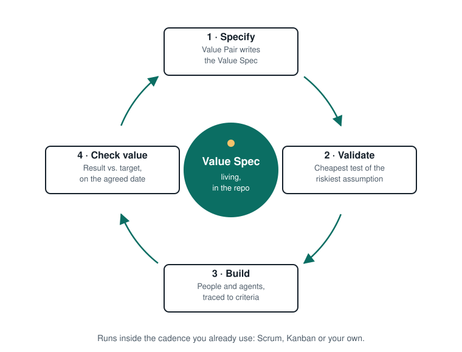

# Practices

Value-First has four signature practices and one optional practice. They run inside the cadence you already use. In Scrum they live in refinement and review. In Kanban they become explicit policies on your board.

**The cycle for each item:** Specify → Validate → Build → Check value, then back to the spec.

---

## 1. Write the Value Spec as a pair

Product and the Tech Lead write one [Value Spec](../../templates/en/value-spec.md) per relevant item, together, in a single working session. It should fit on about one page. The team reviews it and asks questions before it's ready.

- **Product** writes the problem, who it's for, the expected value and how it will be measured.
- **The Tech Lead** writes the constraints and non-functional requirements, turns criteria into testable statements and makes sure an agent could act on it without guessing.
- **What isn't known** goes under "Open questions". Nobody guesses.

*What counts as relevant:* anything with real uncertainty about value or feasibility, or anything that will be built with significant help from coding agents. A typo fix doesn't need a Value Spec.

## 2. Spec readiness check

Before anyone builds, whether people or agents, the spec answers five questions:

1. What problem are we solving?
2. For whom?
3. What value do we expect?
4. How will we measure it?
5. What is fixed and what is flexible?

If one has no answer, the spec isn't ready yet. In Scrum, this is a refinement criterion (similar to a Definition of Ready). In Kanban, it's the explicit entry policy for your "ready to build" column.

## 3. Prototype as a question

For high-uncertainty items, build a cheap prototype that answers **one** question about value or feasibility before committing. It's often a clickable flow or throwaway code generated with AI in hours. The prototype code is disposable by default. The decision it led to goes into the spec, under "Validation plan".

## 4. Value check

After delivery, on the date the spec named, compare the result with the success criteria. Write down what you learned, update the spec and adjust the backlog. This closes the loop. A team practicing Value-First can name deliveries that **did not** create the expected value, and what it did next.

In Scrum, the value check complements the Sprint Review. It often happens weeks later, when the metric has had time to move.

## 5. Alignment Canvas session *(optional, for larger initiatives)*

Before breaking a large initiative into Value Specs, run a kickoff with the [Value-Technology Alignment Canvas](./canvas/value-technology-alignment-canvas.svg). It puts business and technical perspectives on one page. The output is a set of candidate Value Specs, not a plan.

---

## Compatible techniques (with credit)

Value-First doesn't reinvent these. They're good ways to fill in a Value Spec:

| Technique | Use it for | Source |
|---|---|---|
| Specification by Example / BDD | Writing success criteria as concrete examples | Gojko Adzic, *Specification by Example* (Manning, 2011), [gojko.net](https://gojko.net/books/specification-by-example/); BDD: Dan North, [Introducing BDD](https://dannorth.net/introducing-bdd/) (2006) |
| EARS | Writing behavioral criteria an agent can map to tasks | Alistair Mavin, [alistairmavin.com/ears](https://alistairmavin.com/ears/) |
| Impact Mapping | Linking a deliverable to a business goal | Gojko Adzic (2012), [impactmapping.org](https://www.impactmapping.org/) |
| User Story Mapping | Building shared understanding of the whole journey before slicing | Jeff Patton (O'Reilly, 2014), [jpattonassociates.com](https://jpattonassociates.com/story-mapping/) |
| Continuous discovery | Interviews and assumption tests to fill "expected value" | Teresa Torres, [producttalk.org](https://www.producttalk.org/2021/08/product-discovery/) |
| Shaping and appetite | Deciding how much a problem is worth before you solve it | Ryan Singer, *Shape Up* (2019), [basecamp.com/shapeup](https://basecamp.com/shapeup) |
| Event Storming, Domain Storytelling | Exploring a complex domain before writing specs | Alberto Brandolini, [eventstorming.com](https://www.eventstorming.com/); Hofer & Schwentner, *Domain Storytelling* (Addison-Wesley, 2021), [domainstorytelling.org](https://domainstorytelling.org/) |
| ADRs | Recording technical decisions the spec links to | Michael Nygard, [cognitect.com](https://www.cognitect.com/blog/2011/11/15/documenting-architecture-decisions) |

---

**From v1.** v1 listed 22 practices. Most were well-known techniques (above) or ceremonies that added overhead. Flexibility Contracts and the Technical Complexity Map are now sections of the Value Spec. Value Checkpoints became the value check. The full v1 list is in [docs/archive/v1](../archive/v1/en/practices.md).
