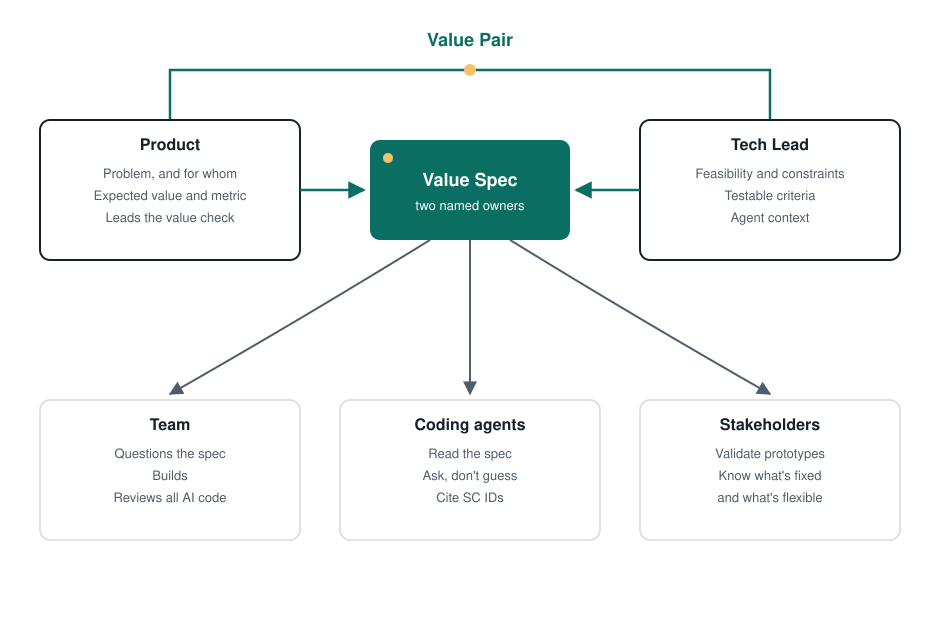

# Roles and artifacts

Value-First adds no job titles and no new meetings. It gives a name and a partner to work that already happens.

## Roles

### The Value Pair: Product + Tech Lead

The Value Spec has two named owners.

| Role | Owns in Value-First |
|---|---|
| **Product** (Product Owner / Product Manager) | The problem, the expected value and the success metrics. Leads the value check. |
| **Tech Lead** | Feasibility, constraints, non-functional requirements and making the spec buildable by people and agents. Owns the agent context (AGENTS.md, CLAUDE.md, rules). |
| **Development team** | Reviews and questions the spec. Builds. **Reviews every piece of AI-generated code.** Says when reality diverges from the spec. |
| **Stakeholders** | Help validate value (prototype, value check). Know what's fixed and what's flexible. |

In Scrum, the pair is the Product Owner plus the Developer who acts as Tech Lead. Nobody new has to be hired.

### The Tech Lead as specification engineer

Many Tech Leads already translate intent into something buildable. They complete stories, decide edge cases and add constraints (see [Why Value-First](./why.md)). With coding agents, that work becomes central: the agent builds what the spec says, so someone has to make the spec say enough.

Value-First makes that work explicit and shares it with Product. The Tech Lead doesn't do Product's job. Product doesn't hand off a half-spec and leave. They write it together.

### What happened to the Value Analyst

v1 had a separate "Value Analyst" role between business and technology. v2 drops it as a job title, for one reason: a third role between Product and Tech adds a handoff, and handoffs are exactly where context gets lost. With agents, every extra handoff is one more chance for the spec to lose information before it becomes code.

"Value analysis" stays as a **hat**: a facilitation skill anyone can wear, such as a business analyst in a large company. It's never a required step in the flow. ([Decision D3](../../DECISIONS.md))

---

## Artifacts

### 1. Value Spec (central)

One page in Markdown, in the repository, next to the code. It covers the problem, expected value, measurable success criteria, scope and non-goals, constraints, assumptions, open questions, the validation plan, a decisions log, a change log and instructions for agents.

It's living: versioned with the code and changed with a reason. Tasks, commits and PRs cite its ID and the success-criterion IDs.

→ [Template](../../templates/en/value-spec.md) · [Filled example](../../templates/en/value-spec-example.md)

### 2. Agent context snippet

A short block for your `AGENTS.md`, `CLAUDE.md` or rules file. It tells coding agents to read the Value Spec before acting, to ask instead of guessing and to cite criterion IDs.

→ [Snippet](../../templates/en/agents-snippet.md)

### 3. Value Map (optional)

A one-page drawing for larger initiatives, inspired by the C4 model: the outcome at the top, the Value Specs that move it, and the criteria of one spec when you zoom in. It replaces the v1 Value-Technology Alignment Canvas.

→ [Value Map](./value-map.md) · [Template](../../templates/en/value-map.md)

### What happened to the other v1 artifacts

| v1 artifact | In v2 |
|---|---|
| Flexibility Contract | The "Fixed vs. flexible" part of the Value Spec (scope, non-goals, change log) |
| Technical Complexity Map | The "Constraints" and "Assumptions & risks" sections |
| Value Matrix | Optional. A simple table of Value Specs ranked by expected value and effort is enough |
