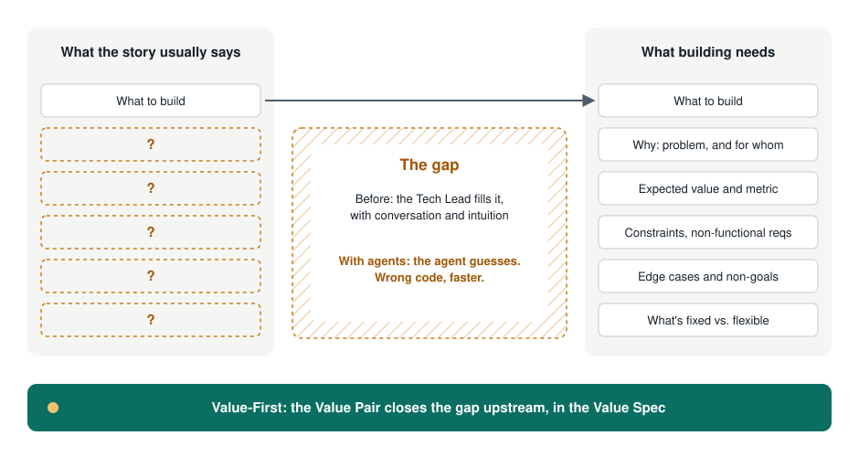

# Why Value-First

> **Value-First Development makes the value of each piece of work explicit, shared and measurable before anyone builds it, so that people and coding agents build the right thing, not only build it fast.**
>
> *From ritual to value, from spec to software.*

---

## What we learned, and where we can go

Every way of working we use today was an answer to a real problem.

- **Writing things down first** (what we now call Waterfall) gave us the discipline of stating intent before building. Even Winston Royce's 1970 paper, often cited as its origin, warned against the single-pass version and recommended iterating ([Royce, via Wikipedia](https://en.wikipedia.org/wiki/Winston_W._Royce)).
- **Agile** gave us short feedback loops and a clear priority: "early and continuous delivery of valuable software" ([Agile Manifesto principles, 2001](https://agilemanifesto.org/principles.html)).
- **Scrum** gave us a steady cadence and three pillars: transparency, inspection and adaptation. The Scrum Guide itself describes Scrum as a framework to "generate value through adaptive solutions for complex problems" ([Scrum Guide, 2020](https://scrumguides.org/scrum-guide.html)).

Value-First keeps all of that. It doesn't replace your cadence, your board or your tools. It adds one thing on top: a short, shared, measurable statement of value at the start of each piece of work.

## The pattern we keep seeing

In many teams, the events stay and the purpose fades. Planning, dailies and reviews happen on time, while the question "what value are we delivering, and how will we know?" goes unanswered. This isn't a flaw in the Scrum Guide, which puts value at its center. It's something that happens in practice, and people who helped shape Agile have described it themselves:

- Martin Fowler, a signatory of the Agile Manifesto, criticized methods "imposed" on teams and asked the industry to "organize around products" ([The State of Agile Software in 2018](https://martinfowler.com/articles/agile-aus-2018.html)).
- Ron Jeffries, also a signatory, described "Dark Scrum", Scrum applied without its intent, and pointed to the practices that lead out of it ([Dark Scrum, 2016](https://ronjeffries.com/articles/016-09ff/defense/)).
- Marty Cagan distinguishes teams "measured by outcomes (rather than output)" from teams working down "a prioritized list that is called the roadmap" ([Product vs. Feature Teams, 2019](https://www.svpg.com/product-vs-feature-teams/)).

**Our observation** (a hypothesis from practice, not a measured fact): when the ritual takes the place of the purpose, a gap opens between the product specification and what development needs to build software. Stories describe *what*, rarely *why*, and almost never the constraints, edge cases or how success will be measured.

## Who fills the gap today: the Tech Lead

Someone has to close that gap, and it's usually the Tech Lead. They ask the clarifying questions, fill in the missing constraints, decide the edge cases and turn intent into something buildable.

This isn't new. Patrick Kua defines the Tech Lead as responsible for "alignment of the technical direction", working with product on the *how* while product owns the *what* ([The Definition of a Tech Lead](https://www.patkua.com/blog/the-definition-of-a-tech-lead/)). Camille Fournier describes the role as a mix of "systems architect, business analyst, project planner, software developer, and team leader" (*The Manager's Path*, O'Reilly, 2017, ch. 3, as quoted [here](https://www.welcometothejungle.com/en/articles/btc-manager-path-camille-fournier)). The "business analyst" part is the translation work.

It works, often well. But it has costs:

- **It's invisible.** The work isn't planned, named or credited.
- **It lives in one head.** When that person is away, the context goes with them.
- **It happens late.** Gaps are found during build, when changing course costs more.

## Why this matters more now

Coding agents read specs and act on them. A person compensates for a vague story with conversation and intuition. An agent executes what is written and guesses the rest. As GitHub put it when launching Spec Kit, language models are "exceptional at pattern completion, but not at mind reading" ([GitHub Blog, 2025](https://github.blog/ai-and-ml/generative-ai/spec-driven-development-with-ai-get-started-with-a-new-open-source-toolkit/)).

DORA's research points the same way. Its 2025 report describes AI as an amplifier that "magnifies the strengths of high-performing organizations and the dysfunctions of struggling ones", and finds that without a user-centric focus, AI adoption can hurt team performance ([DORA 2025](https://cloud.google.com/blog/products/ai-machine-learning/announcing-the-2025-dora-report)).

So the gap went from a nuisance to a bottleneck. **A vague spec now produces the wrong code faster.** The full argument, with sources and limits, is in [Specs in the AI era](./ai-and-specs.md).

## What Value-First proposes

1. **A Value Spec for each relevant piece of work.** One page: problem, expected value, measurable success criteria, constraints, what is fixed and what is flexible. Readable by people and by agents. Versioned next to the code. ([Template](../../templates/en/value-spec.md))
2. **A Value Pair owns it.** Product owns the problem and the value. The Tech Lead owns feasibility, constraints and making the spec buildable. The translation work gets a name and a partner. It's no longer one person's invisible job.
3. **Validate before you build.** Use the cheapest way to reduce the biggest uncertainty, often a throwaway prototype generated with AI.
4. **Close the loop.** After delivery, check the result against the success criteria and update the spec.

It runs inside whatever cadence you already have: Scrum, Kanban or something of your own. See [principles](./principles.md), [practices](./practices.md) and [how it compares](./comparison.md).

## What Value-First is not

- **Not a replacement for Scrum, Kanban or Shape Up.** It's a layer that improves what goes into them and checks what comes out.
- **Not a return to big upfront documents.** Specs are small, value-scoped and living.
- **Not an AI tool.** It works with or without agents. Agents just make the need more visible.
- **Not new ideas.** Specification by Example, Impact Mapping, Shape Up and outcome-focused product work all came first. Value-First combines them into a minimum set and applies them to a new situation: specs that machines now execute.
