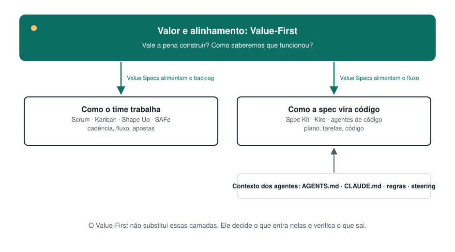

# Como o Value-First se compara

Uma comparação honesta. Cada abordagem abaixo resolve bem problemas reais. O Value-First é uma camada que funciona **junto com** a maioria delas.

## Visão geral

| | **Value-First** | **Scrum** | **Kanban** | **Shape Up** | **Spec-driven development** |
|---|---|---|---|---|---|
| **Pergunta principal** | Vale a pena construir isso, e como vamos saber que funcionou? | Como inspecionamos e adaptamos em ciclos curtos? | Como o trabalho flui, e onde ele trava? | No que vale a pena apostar, e quanto tempo isso vale? | Como transformamos intenção em plano, tarefas e código com agentes? |
| **Unidade** | Um item de valor (Value Spec) | Sprint e Product Backlog Item | Item de trabalho em um quadro | Ciclo de seis semanas e pitch | Spec de funcionalidade |
| **Cadência** | Nenhuma própria. Usa a sua. | Sprints fixas de um mês ou menos | Contínua | Ciclos de 6 semanas + 2 semanas de cool-down | Nenhuma própria |
| **Papéis** | Par de Valor (Produto + Tech Lead), sem cargos novos | Product Owner, Scrum Master, Developers | Nenhum obrigatório | Shapers, builders, betting table | Nenhum obrigatório |
| **Artefato central** | Value Spec (viva, no repositório) | Product Backlog, Sprint Backlog, Increment | Quadro, limites de WIP, políticas explícitas | Pitch | Spec, plano, tarefas |
| **Como o valor é medido** | Critérios de sucesso com métrica, linha de base, meta e data de verificação de valor | Product Goal; a Sprint Review inspeciona o Increment | Métricas de fluxo (WIP, vazão, cycle time, idade do item) | Apetite e hill charts. Não prescreve métricas de resultado | Não abordado |
| **Agentes de IA** | A spec é escrita para ser lida por agentes | Não abordado (agnóstico a ferramentas) | Não abordado (agnóstico a ferramentas) | Não abordado | Propósito central |
| **Relação** | — | **Complementar**: melhora a entrada da sprint e acrescenta uma verificação de valor posterior | **Complementar**: a checagem de prontidão vira uma política de coluna | **Parente mais próximo**: sobrepõe-se no shaping, complementar no resto | **Complementar**: o Value-First fica acima dele |

Fontes: [Scrum Guide 2020](https://scrumguides.org/scrum-guide.html) · [Kanban Guide](https://kanbanguides.org/english/) e Anderson, *Kanban* (2010) · [Shape Up](https://basecamp.com/shapeup) · [GitHub Spec Kit](https://github.com/github/spec-kit), [Kiro](https://kiro.dev/docs/specs/), [Böckeler 2025](https://martinfowler.com/articles/exploring-gen-ai/sdd-3-tools.html).

## Em mais detalhe

### Scrum
**O que faz bem:** cadência, transparência, inspeção e adaptação, times multifuncionais, um Product Goal.
**Como o Value-First se encaixa:** não mexe nos eventos nem nas responsabilidades do Scrum. As Value Specs deixam os Product Backlog Items prontos para o refinamento, e a verificação de valor estende a Sprint Review para resultados medidos depois. O Par de Valor é o Product Owner mais o Developer que atua como Tech Lead.
**A diferença verificável:** o Scrum pede que você inspecione o Increment a cada sprint. O Value-First pede que você declare, antes de construir, qual métrica deve se mexer e quanto, e que verifique isso em uma data.

### Kanban
**O que faz bem:** visualizar o fluxo, limitar o trabalho em andamento, políticas explícitas, métricas de fluxo.
**Como o Value-First se encaixa:** "Spec pronta" vira a política explícita de entrada de uma coluna, e "valor verificado" vira uma etapa final.

### Shape Up
**O que faz bem:** dar forma ao trabalho antes de apostar nele, apetite em vez de estimativas, tempo fixo e escopo variável.
**Como o Value-First se encaixa:** o Shape Up é o parente mais próximo e merece o crédito. Um pitch e uma Value Spec declaram o problema e definem limites. O Value-First acrescenta critérios de sucesso mensuráveis, uma spec escrita para agentes, uma spec viva no repositório e uma verificação de valor depois da entrega. Ele não prescreve ciclos de seis semanas. Um time que usa Shape Up pode escrever o pitch como uma Value Spec.

### Spec-driven development (Spec Kit, Kiro e outros)
**O que faz bem:** transformar uma spec em plano, tarefas e código com agentes, e padronizar o contexto dos agentes.
**Como o Value-First se encaixa:** acima dele. O Value-First decide *o que vale a pena construir e como vamos saber*. As ferramentas de SDD cuidam de *spec → código*. Uma Value Spec pode alimentar a etapa `specify` do Spec Kit ou a fase de requisitos do Kiro. Veja [Specs na era da IA](./ai-and-specs.md).

### SAFe
**O que faz bem:** coordenação em escala, alinhamento de portfólio e estratégico ([framework.scaledagile.com](https://framework.scaledagile.com/)).
**Como o Value-First se encaixa:** escopo diferente. O Value-First trabalha no nível de um time e de um item, não do portfólio. As Value Specs podem alimentar as features do SAFe.

## O que o Value-First não afirma

- **Não afirma ser novo em suas partes.** Specification by Example, Impact Mapping, Shape Up e o trabalho de produto orientado a resultados vieram antes ([práticas: técnicas compatíveis](./practices.md#técnicas-compatíveis-com-crédito)).
- **Não afirma ser melhor do que nenhuma das abordagens acima.** Ele trata de uma pergunta mais estreita, que se torna mais urgente quando agentes executam specs.
- **Ainda não tem dados de resultado.** É um framework construído a partir da prática e de pesquisas publicadas sobre IA e entrega. Evidências de times que o adotarem são bem-vindas ([contribua](../../CONTRIBUTING.md)).
