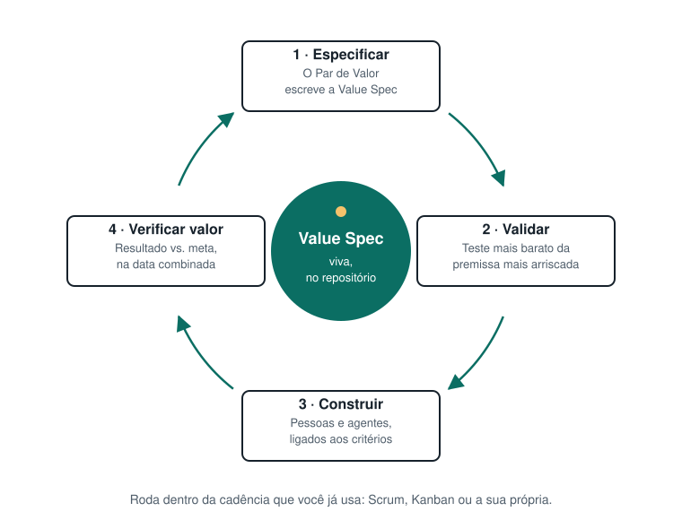

# Práticas

O Value-First tem quatro práticas características e uma prática opcional. Elas acontecem dentro da cadência que você já usa. No Scrum, ficam no refinamento e na review. No Kanban, viram políticas explícitas no seu quadro.

**O ciclo de cada item:** Especificar → Validar → Construir → Verificar o valor, e de volta à spec.

---

## 1. Escrevam a Value Spec em dupla

Produto e o Tech Lead escrevem uma [Value Spec](../../templates/pt/value-spec.md) para cada item relevante, juntos, em uma única sessão de trabalho. Ela deve caber em mais ou menos uma página. O time revisa e faz perguntas antes de ela ficar pronta.

- **Produto** escreve o problema, para quem é, o valor esperado e como ele será medido.
- **O Tech Lead** escreve as restrições e os requisitos não funcionais, transforma os critérios em afirmações testáveis e garante que um agente conseguiria agir a partir dela sem adivinhar.
- **O que não se sabe** vai para "Perguntas em aberto". Ninguém adivinha.

*O que conta como relevante:* qualquer coisa com incerteza real sobre valor ou viabilidade, ou qualquer coisa que será construída com ajuda significativa de agentes de código. Corrigir um erro de digitação não precisa de Value Spec.

## 2. Checagem de prontidão da spec

Antes de alguém construir, sejam pessoas ou agentes, a spec responde a cinco perguntas:

1. Que problema estamos resolvendo?
2. Para quem?
3. Que valor esperamos?
4. Como vamos medir?
5. O que é fixo e o que é flexível?

Se alguma ficar sem resposta, a spec ainda não está pronta. No Scrum, isso é um critério de refinamento (parecido com uma Definition of Ready). No Kanban, é a política explícita de entrada da sua coluna "pronto para construir".

## 3. Protótipo como pergunta

Para itens de alta incerteza, construa um protótipo barato que responda a **uma** pergunta sobre valor ou viabilidade antes de se comprometer. Muitas vezes é um fluxo clicável ou código descartável gerado com IA em poucas horas. O código do protótipo é descartável por padrão. A decisão a que ele levou vai para a spec, em "Plano de validação".

## 4. Verificação de valor

Depois da entrega, na data que a spec definiu, compare o resultado com os critérios de sucesso. Anote o que vocês aprenderam, atualize a spec e ajuste o backlog. É isso que fecha o ciclo. Um time que pratica Value-First consegue citar entregas que **não** geraram o valor esperado, e o que fez em seguida.

No Scrum, a verificação de valor complementa a Sprint Review. Ela costuma acontecer semanas depois, quando a métrica já teve tempo de se mexer.

## 5. Sessão do Canvas de Alinhamento *(opcional, para iniciativas maiores)*

Antes de quebrar uma iniciativa grande em Value Specs, faça um kickoff com o [Canvas de Alinhamento Valor-Tecnologia](./canvas/value-technology-alignment-canvas.svg). Ele coloca as perspectivas de negócio e técnica em uma única página. O resultado é um conjunto de Value Specs candidatas, não um plano.

---

## Técnicas compatíveis (com crédito)

O Value-First não reinventa estas técnicas. Elas são boas formas de preencher uma Value Spec:

| Técnica | Use para | Fonte |
|---|---|---|
| Specification by Example / BDD | Escrever critérios de sucesso como exemplos concretos | Gojko Adzic, *Specification by Example* (Manning, 2011), [gojko.net](https://gojko.net/books/specification-by-example/); BDD: Dan North, [Introducing BDD](https://dannorth.net/introducing-bdd/) (2006) |
| EARS | Escrever critérios de comportamento que um agente consegue relacionar a tarefas | Alistair Mavin, [alistairmavin.com/ears](https://alistairmavin.com/ears/) |
| Impact Mapping | Ligar uma entrega a um objetivo de negócio | Gojko Adzic (2012), [impactmapping.org](https://www.impactmapping.org/) |
| User Story Mapping | Construir um entendimento compartilhado da jornada inteira antes de fatiar | Jeff Patton (O'Reilly, 2014), [jpattonassociates.com](https://jpattonassociates.com/story-mapping/) |
| Descoberta contínua | Entrevistas e testes de premissas para preencher o "valor esperado" | Teresa Torres, [producttalk.org](https://www.producttalk.org/2021/08/product-discovery/) |
| Shaping e apetite | Decidir quanto um problema vale antes de resolvê-lo | Ryan Singer, *Shape Up* (2019), [basecamp.com/shapeup](https://basecamp.com/shapeup) |
| Event Storming, Domain Storytelling | Explorar um domínio complexo antes de escrever specs | Alberto Brandolini, [eventstorming.com](https://www.eventstorming.com/); Hofer & Schwentner, *Domain Storytelling* (Addison-Wesley, 2021), [domainstorytelling.org](https://domainstorytelling.org/) |
| ADRs | Registrar decisões técnicas às quais a spec faz referência | Michael Nygard, [cognitect.com](https://www.cognitect.com/blog/2011/11/15/documenting-architecture-decisions) |

---

**Da v1.** A v1 listava 22 práticas. A maioria eram técnicas conhecidas (acima) ou cerimônias que adicionavam sobrecarga. Os Contratos de Flexibilidade e o Mapa de Complexidade Técnica agora são seções da Value Spec. Os Checkpoints de Valor viraram a verificação de valor. A lista completa da v1 está em [docs/archive/v1](../archive/v1/pt/practices.md).
