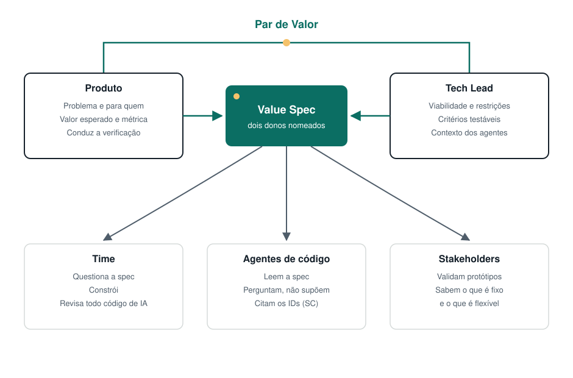

# Papéis e artefatos

O Value-First não cria cargos nem reuniões novas. Ele dá um nome e um parceiro a um trabalho que já acontece.

## Papéis

### O Par de Valor: Produto + Tech Lead

A Value Spec tem dois donos nomeados.

| Papel | É dono, no Value-First, de |
|---|---|
| **Produto** (Product Owner / Product Manager) | O problema, o valor esperado e as métricas de sucesso. Conduz a verificação de valor. |
| **Tech Lead** | Viabilidade, restrições, requisitos não funcionais e tornar a spec construível por pessoas e agentes. É dono do contexto dos agentes (AGENTS.md, CLAUDE.md, rules). |
| **Time de desenvolvimento** | Revisa e questiona a spec. Constrói. **Revisa todo código gerado por IA.** Avisa quando a realidade se afasta da spec. |
| **Stakeholders** | Ajudam a validar o valor (protótipo, verificação de valor). Sabem o que é fixo e o que é flexível. |

No Scrum, o par é o Product Owner mais o Developer que atua como Tech Lead. Ninguém novo precisa ser contratado.

### O Tech Lead como engenheiro de especificação

Muitos Tech Leads já traduzem a intenção em algo construível. Eles completam histórias, decidem casos de borda e acrescentam restrições (veja [Por que Value-First](./why.md)). Com agentes de código, esse trabalho se torna central: o agente constrói o que a spec diz, então alguém precisa fazer a spec dizer o suficiente.

O Value-First torna esse trabalho explícito e o divide com Produto. O Tech Lead não faz o trabalho de Produto. Produto não entrega meia spec e vai embora. Os dois escrevem juntos.

### O que aconteceu com o Analista de Valor

A v1 tinha um papel separado de "Analista de Valor" entre negócio e tecnologia. A v2 deixa de tratá-lo como cargo, por um motivo: um terceiro papel entre Produto e Tecnologia adiciona uma passagem de bastão, e é justamente nas passagens de bastão que o contexto se perde. Com agentes, cada passagem a mais é mais uma chance de a spec perder informação antes de virar código.

A "análise de valor" continua como um **chapéu**: uma habilidade de facilitação que qualquer pessoa pode vestir, como um analista de negócios em uma empresa grande. Nunca é uma etapa obrigatória do fluxo. ([Decisão D3](../../DECISIONS.md))

---

## Artefatos

### 1. Value Spec (central)

Uma página em Markdown, no repositório, ao lado do código. Cobre o problema, o valor esperado, critérios de sucesso mensuráveis, escopo e o que fica fora do escopo, restrições, premissas, perguntas em aberto, o plano de validação, um registro de decisões, um registro de mudanças e instruções para agentes.

Ela é viva: versionada com o código e alterada com um motivo. Tarefas, commits e PRs citam o seu ID e os IDs dos critérios de sucesso.

→ [Template](../../templates/pt/value-spec.md) · [Exemplo preenchido](../../templates/pt/value-spec-example.md)

### 2. Snippet de contexto para agentes

Um bloco curto para o seu `AGENTS.md`, `CLAUDE.md` ou arquivo de rules. Ele orienta os agentes de código a ler a Value Spec antes de agir, a perguntar em vez de adivinhar e a citar os IDs dos critérios.

→ [Snippet](../../templates/pt/agents-snippet.md)

### 3. Mapa de Valor (opcional)

Um desenho de uma página para iniciativas maiores, inspirado no modelo C4: o resultado no topo, e as Value Specs que o movem, como uma lista de apostas. Dar zoom numa fatia abre a Value Spec dela. Substitui o Canvas de Alinhamento Valor-Tecnologia da v1.

→ [Mapa de Valor](./value-map.md) · [Template](../../templates/pt/value-map.md)

### O que aconteceu com os outros artefatos da v1

| Artefato da v1 | Na v2 |
|---|---|
| Contrato de Flexibilidade | A parte "Fixo vs. flexível" da Value Spec (escopo, fora do escopo, registro de mudanças) |
| Mapa de Complexidade Técnica | As seções "Restrições" e "Premissas e riscos" |
| Matriz de Valor | Opcional. Uma tabela simples de Value Specs ordenadas por valor esperado e esforço é suficiente |
