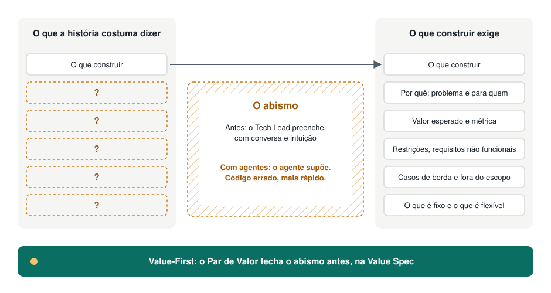

# Por que Value-First

> **Value-First Development torna o valor de cada trabalho explícito, compartilhado e mensurável antes que alguém comece a construí-lo, para que pessoas e agentes de código construam a coisa certa, e não apenas construam rápido.**
>
> *Do ritual ao valor, da spec ao software.*

---

## O que aprendemos, e para onde podemos ir

Cada forma de trabalhar que usamos hoje foi uma resposta a um problema real.

- **Escrever antes de construir** (o que hoje chamamos de Waterfall) nos deu a disciplina de declarar a intenção antes de construir. O próprio artigo de Winston Royce, de 1970, muitas vezes citado como sua origem, alertava contra a versão de passagem única e recomendava iterar ([Royce, via Wikipedia](https://en.wikipedia.org/wiki/Winston_W._Royce)).
- **Agile** nos deu ciclos curtos de feedback e uma prioridade clara: "entrega antecipada e contínua de software de valor" ([princípios do Manifesto Ágil, 2001](https://agilemanifesto.org/principles.html)).
- **Scrum** nos deu uma cadência estável e três pilares: transparência, inspeção e adaptação. O próprio Scrum Guide descreve o Scrum como um framework para "gerar valor por meio de soluções adaptativas para problemas complexos" ([Scrum Guide, 2020](https://scrumguides.org/scrum-guide.html)).

Value-First mantém tudo isso. Não substitui sua cadência, seu quadro nem suas ferramentas. Acrescenta uma única coisa por cima: uma declaração de valor curta, compartilhada e mensurável no início de cada trabalho.

## O padrão que continuamos vendo

Em muitos times, os eventos permanecem e o propósito se perde. Planning, dailies e reviews acontecem no horário, enquanto a pergunta "que valor estamos entregando, e como vamos saber?" fica sem resposta. Isso não é uma falha do Scrum Guide, que coloca o valor no centro. É algo que acontece na prática, e pessoas que ajudaram a construir o Agile já descreveram isso:

- Martin Fowler, signatário do Manifesto Ágil, criticou métodos "impostos" aos times e pediu que a indústria se "organize em torno de produtos" ([The State of Agile Software in 2018](https://martinfowler.com/articles/agile-aus-2018.html)).
- Ron Jeffries, também signatário, descreveu o "Dark Scrum", o Scrum aplicado sem a sua intenção, e apontou as práticas que levam para fora dele ([Dark Scrum, 2016](https://ronjeffries.com/articles/016-09ff/defense/)).
- Marty Cagan diferencia times "medidos por resultados (e não por entregas)" de times que vão consumindo "uma lista priorizada chamada roadmap" ([Product vs. Feature Teams, 2019](https://www.svpg.com/product-vs-feature-teams/)).

**Nossa observação** (uma hipótese da prática, não um fato medido): quando o ritual ocupa o lugar do propósito, abre-se um abismo entre a especificação de produto e o que o desenvolvimento precisa para construir software. As histórias descrevem *o quê*, raramente *por quê*, e quase nunca as restrições, os casos de borda ou como o sucesso será medido.

## Quem preenche esse abismo hoje: o Tech Lead

Alguém precisa fechar esse abismo, e normalmente é o Tech Lead. É quem faz as perguntas de esclarecimento, completa as restrições que faltam, decide os casos de borda e transforma a intenção em algo construível.

Isso não é novo. Patrick Kua define o Tech Lead como responsável pelo "alinhamento da direção técnica", trabalhando com produto no *como* enquanto produto é dono do *o quê* ([The Definition of a Tech Lead](https://www.patkua.com/blog/the-definition-of-a-tech-lead/)). Camille Fournier descreve o papel como uma mistura de "arquiteto de sistemas, analista de negócios, planejador de projetos, desenvolvedor de software e líder de time" (*The Manager's Path*, O'Reilly, 2017, cap. 3, conforme citado [aqui](https://www.welcometothejungle.com/en/articles/btc-manager-path-camille-fournier)). A parte de "analista de negócios" é o trabalho de tradução.

Funciona, muitas vezes bem. Mas tem custos:

- **É invisível.** O trabalho não é planejado, nomeado nem reconhecido.
- **Fica na cabeça de uma pessoa.** Quando ela não está, o contexto vai junto.
- **Acontece tarde.** As lacunas aparecem durante a construção, quando mudar de rumo custa mais.

## Por que isso importa mais agora

Agentes de código leem specs e agem a partir delas. Uma pessoa compensa uma história vaga com conversa e intuição. Um agente executa o que está escrito e adivinha o resto. Como o GitHub disse ao lançar o Spec Kit, modelos de linguagem são "excepcionais em completar padrões, mas não em ler mentes" ([GitHub Blog, 2025](https://github.blog/ai-and-ml/generative-ai/spec-driven-development-with-ai-get-started-with-a-new-open-source-toolkit/)).

A pesquisa do DORA aponta na mesma direção. O relatório de 2025 descreve a IA como um amplificador que "magnifica os pontos fortes das organizações de alto desempenho e as disfunções das que enfrentam dificuldades", e conclui que, sem foco no usuário, a adoção de IA pode prejudicar o desempenho do time ([DORA 2025](https://cloud.google.com/blog/products/ai-machine-learning/announcing-the-2025-dora-report)).

Então o abismo deixou de ser um incômodo e virou um gargalo. **Uma spec vaga agora produz o código errado mais rápido.** O argumento completo, com fontes e limites, está em [Specs na era da IA](./ai-and-specs.md).

## O que Value-First propõe

1. **Uma Value Spec para cada trabalho relevante.** Uma página: problema, valor esperado, critérios de sucesso mensuráveis, restrições, o que é fixo e o que é flexível. Legível por pessoas e por agentes. Versionada junto com o código. ([Template](../../templates/pt/value-spec.md))
2. **Um Par de Valor é dono dela.** Produto é dono do problema e do valor. O Tech Lead é dono da viabilidade, das restrições e de tornar a spec construível. O trabalho de tradução ganha um nome e um parceiro. Deixa de ser o trabalho invisível de uma pessoa só.
3. **Valide antes de construir.** Use a forma mais barata de reduzir a maior incerteza, muitas vezes um protótipo descartável gerado com IA.
4. **Feche o ciclo.** Depois da entrega, compare o resultado com os critérios de sucesso e atualize a spec.

Funciona dentro da cadência que você já tem: Scrum, Kanban ou algo próprio. Veja os [princípios](./principles.md), as [práticas](./practices.md) e [como se compara](./comparison.md).

## O que Value-First não é

- **Não é um substituto para Scrum, Kanban ou Shape Up.** É uma camada que melhora o que entra neles e verifica o que sai.
- **Não é uma volta aos grandes documentos antecipados.** As specs são pequenas, recortadas por valor e vivas.
- **Não é uma ferramenta de IA.** Funciona com ou sem agentes. Os agentes só deixam a necessidade mais visível.
- **Não são ideias novas.** Specification by Example, Impact Mapping, Shape Up e o trabalho de produto orientado a resultados vieram antes. Value-First combina essas ideias em um conjunto mínimo e as aplica a uma situação nova: specs que agora são executadas por máquinas.
